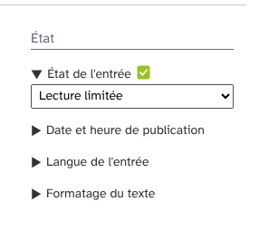
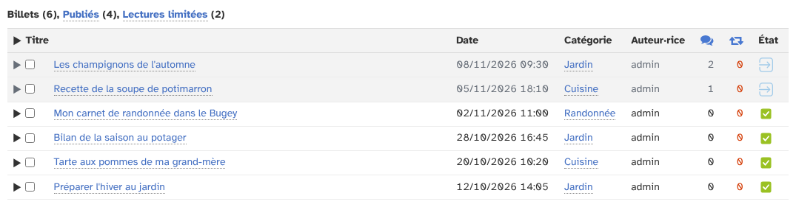
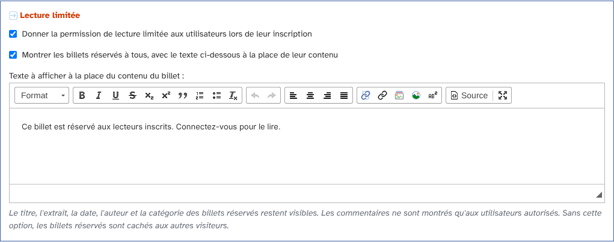
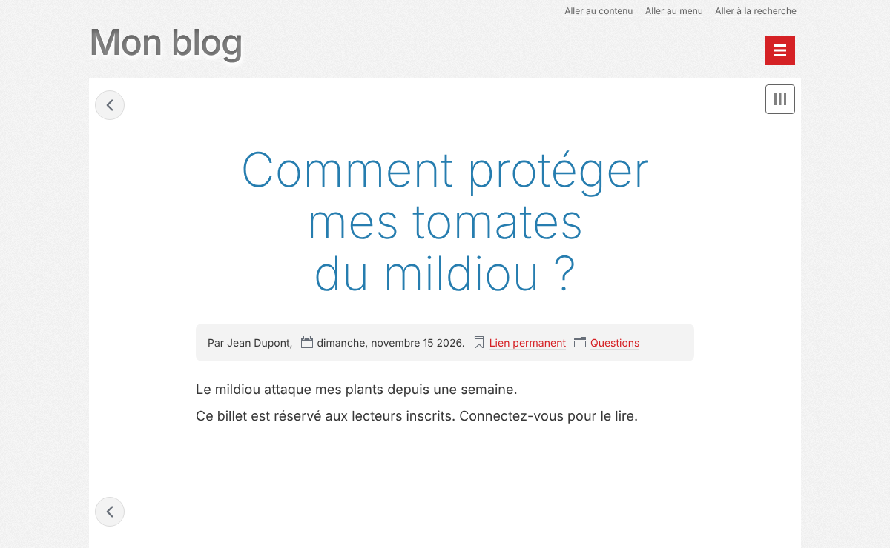

# RestrictedReading : guide d'utilisation

RestrictedReading permet de réserver certains billets aux lecteurs inscrits sur votre blog. Les autres visiteurs ne peuvent pas les lire.

Le plugin a besoin du plugin FrontendSession : c'est lui qui gère la connexion et l'inscription des lecteurs.

## Sommaire

* [Réserver un billet](#réserver-un-billet)
* [Donner l'accès à un lecteur](#donner-laccès-à-un-lecteur)
* [Les réglages du blog](#les-réglages-du-blog)
* [Ce que voient les visiteurs](#ce-que-voient-les-visiteurs)
* [Bon à savoir](#bon-à-savoir)

## Réserver un billet

Le plugin ajoute un état de billet : « Lecture limitée ».

1. Ouvrez un billet dans l'éditeur.
2. Dans la colonne de droite, ouvrez la section « État de l'entrée ».
3. Choisissez « Lecture limitée ».
4. Enregistrez.

Dans la liste des billets, ces billets ont leur propre icône. Le filtre « État » et le titre de la liste les comptent à part.

## Donner l'accès à un lecteur

Un lecteur voit les billets réservés s'il a la permission « Lecture limitée » sur le blog.

Deux façons de l'obtenir :

* Vous la donnez vous-même depuis la fiche de l'utilisateur, dans la section « Permissions ».
* Elle est ajoutée automatiquement à l'inscription, si l'option est cochée (voir plus bas).

Une fois connecté, le lecteur retrouve la mention « Vous avez accès aux lectures limitées. » dans la section « Lecture limitée » de sa page « Mon compte ».

## Les réglages du blog

1. Allez dans « Paramètres du blog ».
2. Ouvrez « Paramètres des plugins pour ce blog ».
3. Dans la section « Lecture limitée », réglez :
   * « Donner la permission de lecture limitée aux utilisateurs lors de leur inscription » : cochée par défaut. Toute personne qui s'inscrit reçoit aussitôt la permission.
   * « Montrer les billets réservés à tous, avec le texte ci-dessous à la place de leur contenu » : voir ci-dessous.
   * « Texte à afficher à la place du contenu du billet : » : le message montré aux visiteurs sans accès.
4. Enregistrez.

## Ce que voient les visiteurs

Cela dépend de la case « Montrer les billets réservés à tous, avec le texte ci-dessous à la place de leur contenu ».

* Case décochée : le billet est invisible pour un visiteur sans la permission. Il n'est pas dans les listes, et son adresse affiche « Document non trouvé ».
* Case cochée : le titre, l'extrait, la date, l'auteur et la catégorie du billet restent visibles, dans les listes comme sur sa page. Son contenu est remplacé par le texte que vous avez saisi. Ses commentaires sont cachés, et on ne peut ni commenter ni envoyer de rétrolien.

Un lecteur qui a la permission voit toujours le billet en entier.

## Bon à savoir

* Le texte de remplacement proposé à l'installation est en anglais : remplacez-le par le vôtre dans les réglages du blog.
* Les flux du blog (Atom et RSS) affichent le texte de remplacement pour un billet réservé quand la case est cochée.
* Les commentaires d'un billet réservé ne sont montrés qu'aux lecteurs qui ont la permission, y compris dans les listes et les flux de commentaires.
